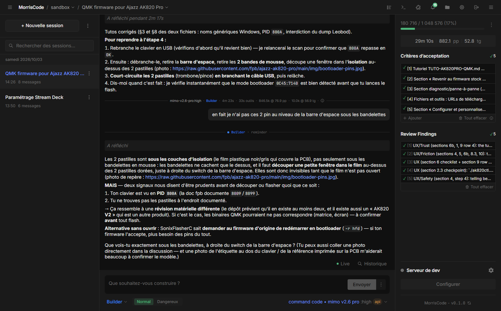

# MorrisCode

**Local-LLM-first agentic coding assistant**

MorrisCode is a fork of [OpenFox](https://github.com/co-l/openfox). The agent engine, the
WebSocket protocol, workflows, plugins and the whole server side are upstream OpenFox; the
product name, the configuration paths and the web interface are MorrisCode's own.

_Session — Criteria tracking, tool calls, and streaming responses_


_Providers — Local LLM backend configuration_


_Workflows — Contract-driven execution pipeline_


## Quick Start

```bash
npm ci
npm run build
npm start
```

MorrisCode is not published to npm — run it from a clone. For development, `npm run dev`
starts the CLI dev server (port 10469, password `password`). On first run, MorrisCode
detects your local LLM backend (vLLM, sglang, ollama, llamacpp) and configures itself.

## Local Network Access & HTTPS

MorrisCode is localhost-only by default. To reach it from your phone or another machine on the same
network, use Settings → Advanced → Network → Local network access, or start it with:

```bash
morriscode --network --https
```

HTTPS uses a generated self-signed certificate on the same port (10369 production, 10469 development);
each device accepts the warning once. See [docs/NETWORK-ACCESS.md](docs/NETWORK-ACCESS.md) for
trusting the certificate, firewall rules and installing it as an app on other devices.

## Migrating from OpenFox

To populate the environment used by `npm run dev` with your real OpenFox providers, models,
projects and sessions, stop MorrisCode dev and run:

```bash
node scripts/migrate-from-openfox.mjs --dev
```

This copies into `morriscode-dev`, leaving OpenFox running and its source files intact. SQLite's
online backup API creates a consistent database snapshot. Existing dev data is backed up before
replacement; providers and models are merged. The copied data persists across dev restarts.
Run the command again only when you want to refresh the snapshot from OpenFox.

```bash
node scripts/migrate-from-openfox.mjs
```

The script copies `auth.json`, `auth.key`, `plugins/`, `skills/` and `workflows/` when
MorrisCode does not have them yet, merges `config.json` so every provider keeps every model it has in
OpenFox (providers and models you added in MorrisCode are preserved), and refreshes `sessions.db` from a
consistent snapshot of OpenFox's database — the previous file is kept next to it as a timestamped
`.pre-migrate-*.bak`.

Re-running it after using OpenFox again is how new sessions and models catch up; `--dry-run` previews
the work, and a project's `.openfox/` directory is copied to `.morriscode/` when you pass its path with
`--project`. The OpenFox originals are never modified or deleted.

## What's New in 2.0

- **Multi-Turn Agent Engine** — Completely rewritten agent loop with EventStore as single source of truth. All modes (builder, planner, verifier, sub-agents, compaction) run through the same unified loop.
- **Provider Dialog** — Comprehensive provider configuration UI with thinking mode (`reasoningEffort`), editable kwargs, profile defaults, and preset management.
- **Auto-Retry Patterns** — Replace the old XML protection toggle with configurable pattern matching. Define your own retry triggers in settings.
- **Unified Image Handling** — Automatic vision model fallback for non-vision models. Images are described before each turn so any model can "see" them.
- **Session Metadata** — Unified `session_metadata` tool replaces separate criterion/todo tools. Interactive criteria editor with CRUD and agent badges.
- **Workflow Sub-Groups** — Run individual workflow steps in isolation. New code review phase in the build-verify pipeline.
- **Parallel `edit_file` Safety** — Per-file mutex prevents race conditions when editing multiple files simultaneously.
- **Firefox Support** — Custom thin scrollbars with hover behavior, cross-browser compatible.

## CLI Commands

```bash
# Start server for current project
morriscode

# Start on custom port
morriscode --port 8080

# Start without opening browser
morriscode --no-browser

# Show current configuration
morriscode config

# Manage LLM providers
morriscode provider add      # Add new provider
morriscode provider list     # List configured providers
morriscode provider use      # Switch active provider
morriscode provider remove   # Remove provider
```

## CLI Options

| Option                | Description                 | Default       |
| --------------------- | --------------------------- | ------------- |
| `-p, --port <number>` | Specify server port         | 10369         |
| `--no-browser`        | Don't open browser on start | Opens browser |
| `-h, --help`          | Show help message           | -             |
| `-v, --version`       | Show version number         | -             |

## Requirements

- Node.js >= 24.0.0
- Local LLM backend with OpenAI-compatible API:
  - vLLM
  - sglang
  - ollama
  - llamacpp

## Features

- **Plan → Builder Workflow**: Interactive task breakdown followed by autonomous implementation
- **Contract-Driven Execution**: Acceptance criteria serve as immutable contract
- **Workflows**: Declarative multi-step pipelines (agent turns, sub-agents, shell commands, user gates) with conditional transitions. File format and authoring reference: [docs/WORKFLOWS.md](docs/WORKFLOWS.md)
- **Iterative Verification**: Agent loops until all criteria pass
- **LSP Integration**: Immediate feedback on code validity
- **Real-Time Metrics**: Prefill time, generation speed, context usage

## Plugins

MorrisCode supports plugins loaded from the `plugins` directory inside its configuration folder. A plugin can contribute LLM providers (auth, transport, presets), model metadata, tools, slash commands, skills, workflow transitions, schema-driven settings, notifications, and declarative UI (header/message/composer actions, session badges, panels).

You can install a plugin from the UI by curated registry entry, GitHub URL, npm package name, or local path — then enable, disable, configure, or remove it without restarting MorrisCode.

Default plugin directories:

- macOS: `~/Library/Application Support/morriscode/plugins`
- Linux: `${XDG_CONFIG_HOME:-~/.config}/morriscode/plugins`
- Windows: `%APPDATA%\morriscode\plugins`

Authoring guide: [docs/PLUGINS.md](docs/PLUGINS.md) — working reference plugin in [examples/hello-plugin](examples/hello-plugin).

- To authenticate with a ChatGPT Plus or Pro account, you can install the [`openfox-chatgpt`](https://github.com/arthurlacoste/openfox-chatgpt) plugin.
- To authenticate with a Github copilot account, you can install the [`openfox-github-copilot`](https://github.com/JamesDAdams/openfox-github-copilot) plugin.
- To authenticate with a Google Antigravity account, you can install the [`openfox-google-antigravity`](https://github.com/JamesDAdams/openfox-google-antigravity) plugin.
- To authenticate with an X (xAI) SuperGrok subscription, you can install the [`openfox-xai-supergrok`](https://github.com/Olgean-Group/openfox-xai-supergrok) plugin.
- To use free OpenRouter models, you can install the [`openfox-openrouter-free`](https://github.com/JamesDAdams/openfox-openrouter-free) plugin.
- To use free OpenCode models, you can install the [`openfox-opencode-free`](https://github.com/JamesDAdams/openfox-opencode-free) plugin.

## Screenshots

_Project Selected — Active session with context stats_


_Stats — Prefill time, generation speed, token usage_


_Terminal — Integrated terminal for running commands_


_Notifications — Event log and system messages_


_Agents — Sub-agent management and execution_


_General Instructions — Global custom instructions_


_Vision Fallback — Image processing configuration_


## Environment Variables

| Variable                                | Default                    | Description                                                     |
| --------------------------------------- | -------------------------- | --------------------------------------------------------------- |
| `MORRISCODE_LLM_URL`                    | `http://localhost:8000/v1` | LLM API base URL                                                |
| `MORRISCODE_VLLM_URL`                   | —                          | Deprecated alias for `MORRISCODE_LLM_URL`                       |
| `MORRISCODE_BACKEND`                    | `unknown`                  | Backend type: `vllm`, `sglang`, `ollama`, `llamacpp`, `unknown` |
| `MORRISCODE_BASE_PATH`                  | `/`                        | Web app base path for subpath deployments (e.g. `/morriscode/`) |
| `MORRISCODE_MODEL_NAME`                 | `''`                       | Override default model name                                     |
| `MORRISCODE_MAX_CONTEXT`                | `200000`                   | Max context window in tokens                                    |
| `MORRISCODE_LLM_TIMEOUT`                | `300000`                   | LLM request timeout in ms                                       |
| `MORRISCODE_LLM_IDLE_TIMEOUT`           | `300000`                   | LLM stream idle timeout in ms                                   |
| `MORRISCODE_PORT`                       | `10369`                    | Server listen port                                              |
| `MORRISCODE_HOST`                       | `127.0.0.1`                | Server bind host                                                |
| `MORRISCODE_PUBLIC_URL`                 | —                          | Public origin used to build the MCP OAuth redirect URI          |
| `MORRISCODE_WORKDIR`                    | `cwd`                      | Working directory                                               |
| `MORRISCODE_DB_PATH`                    | `./morriscode.db`          | SQLite database path                                            |
| `MORRISCODE_LOG_LEVEL`                  | `info`                     | Log level: `debug`, `info`, `warn`, `error`                     |
| `MORRISCODE_REASONING_EFFORT`           | —                          | Reasoning effort (e.g. `none`, `low`, `medium`, `high`)         |
| `MORRISCODE_DEV`                        | `false`                    | Enable dev mode                                                 |
| `MORRISCODE_MODE`                       | `production`               | Force mode: `production`, `development`, `test`                 |
| `MORRISCODE_SERVICE`                    | `false`                    | Run as systemd service (suppresses browser open)                |
| `MORRISCODE_GIT_POLL_INTERVAL`          | `10000`                    | Git status poll interval in ms                                  |
| `MORRISCODE_DISABLE_AUTO_SESSION_TITLE` | `false`                    | Disable automatic session title generation                      |

## License

MIT, inherited from [OpenFox](https://github.com/co-l/openfox) (MIT, © co-l and
contributors). MorrisCode's own changes are released under the same terms.
